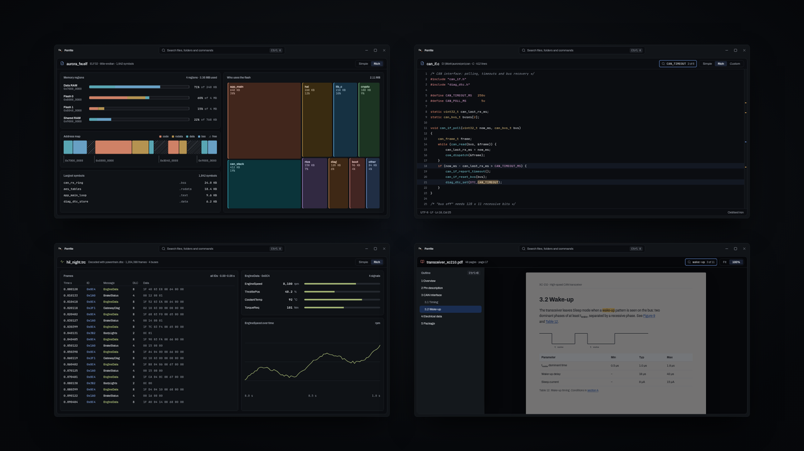
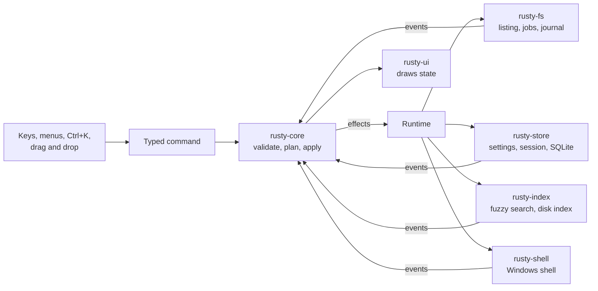

# Navo

A keyboard-first file manager for Windows, written in Rust.

[](design/showreel/navo-showreel.mp4)

The still above links to a two-and-a-half-minute product film ([`design/showreel/navo-showreel.mp4`](design/showreel/navo-showreel.mp4)). The film shows the planned product, not only what is built today. Many of its scenes are on the roadmap and not built yet: tiled panes, saved sets of panes, pins, find by content, archives as folders, the recently deleted view, the drawer with transfers, clipboard and a terminal, compare, CAN traces decoded with a DBC file, plugins and colour themes. Each of those scenes carries a "Planned" tag with its phase. The film is drawn from the feature specs and design prototypes, with invented file names. It is not a recording of the app. The [status](#status) section says what works today.

Navo is the product name. Rusty is the project's codename, so crates and plans still use it.

Navo was called Ferrite before. An existing Ferrite profile moves to Navo on first start, and the old folder is renamed to `Ferrite.migrated-to-navo`.

## What Navo is

Navo is for people who move files all day and want to do it from the keyboard. It keeps the behaviour that makes Total Commander fast: two dense panes, F-keys, Total Commander selection, and no waiting. It does not copy its look. Navo looks calm and modern, and drawers open only when you ask for them.

It is also built for engineers who work with build output. The F3 viewer opens ELF images, linker MAP files, HEX and S-record files, CAN traces and PDF manuals, next to the usual text, JSON, YAML, XML and Markdown.

Navo ships for Windows as a portable build: a zip with `navo.exe`, no installer. It also builds and runs on Linux, which is where most development happens.

## The ideas behind it

Navo started from a short list of things Total Commander does not do. Some are built, some are designed and planned. The table says which.

| Idea | What it means | State on `main` |
| --- | --- | --- |
| One command system | Every action is a typed command. Keys, menus, Ctrl+K, drag and drop and, later, plugins all send the same commands through the same checks. | Built |
| Ctrl+K | One box finds commands, recent folders, open tabs and files. An optional background service keeps a whole-disk index of NTFS drives, so new files show up within a second. | Built |
| Safety model | Every file operation is planned before it runs. Copy, move, rename and delete run as jobs with progress, cancel and a crash-safe journal. Multi-rename is undone with one Ctrl+Z. Invalid settings files are reported and never overwritten. | Built |
| Drawer | Panels that open on demand: the folder preview (F3 on a folder), the job list (Alt+J) and modifier hints. Terminal, compare and clipboard views come later. | Partly built |
| Rich viewers | F3 has simple and rich modes. The rich ELF and MAP view shows memory regions, an address-ordered strip and a treemap of modules. | Built, finishing in the alpha |
| Tiled panes | More than two panes, split like tmux or Hyprland. Today there are two panes with tabs and history. | Planned |
| Saved panel sets | Workspaces on Alt+1 to Alt+9: a saved layout with every pane's tabs, paths, sort and filters. | Planned for the beta |
| Pins | Pinned folders on Ctrl+1 to Ctrl+9, pinned tabs and pinned files. | Planned |
| Plugins | Data packages (themes, keymaps) and sandboxed WebAssembly extensions with explicit permissions. | Designed; planned for v2.0 |

## Status

Navo is in its alpha (v0.5). It is usable, but it is not finished, and it is not yet safe to trust with files you have no other copy of.

- The foundation phase (v0.1) closed on 15 October 2026.
- The alpha is now limited to four features: multi-select with drag and drop, the rich ELF and MAP views, Ctrl+K, and multi-rename. Everything else waits for the beta.
- The [roadmap page](design/roadmap.html) counted 215 of 247 alpha items done on 21 October 2026.
- Each green build of `main` becomes a Windows pre-release on the [releases page](https://github.com/trykA123/rusty/releases). [CHANGELOG.md](CHANGELOG.md) lists what each one changed.

What works today, in short: two panes with tabs, history and session restore; a virtualised file list with sorting and a quick filter; copy, move, rename, new folder, Recycle Bin and Shift+Del with a journal; marking with keys, mouse and lasso; drag and drop between panes and onto tabs, crumbs and drives; copy and paste with Explorer; multi-rename; Ctrl+K with the file index; the preview drawer; the activity strip; settings; light and dark themes.

Known gap: drag and drop with other apps is not finished. Dragging files from Navo into Explorer or an editor does not work yet.

### Roadmap

| Phase | Goal | State |
| --- | --- | --- |
| Foundation, v0.1 | Prove the stack and build the quality gate and CI | Done |
| Alpha, v0.5 | A file manager the owner uses every day on Windows | In progress |
| Beta, v0.9 | Safe, configurable and pleasant: modules, workspaces, undo for every job, themes, installer | Next |
| v1.0 | Replaces Total Commander for daily work: find by content, archives as folders, compare and sync, checksums | Planned |
| v1.1 and v1.2 | Preview pane and thumbnails; Git, duplicates, disk usage, tray and summon hotkey | Planned |
| v2.0 | Open platform: WebAssembly plugins, plugin SDK, embedded terminal, remote file systems | Planned |

The full list, with each item's kind and exit criteria, is in [docs/roadmap.md](docs/roadmap.md).

## How it works

Navo is a Cargo workspace. The UI is drawn with GPUI, the GPU-accelerated framework from the Zed editor, through `gpui-kit`. There is no async runtime in the core.

State has one owner and moves in one direction. `AppState` in `rusty-core` is plain data. It changes only through `apply(command)`, a pure function that returns effects. The runtime carries out those effects (list a folder, start a job, save the session) and feeds the results back as events.



The main crates:

| Crate | Job |
| --- | --- |
| `rusty-core` | Model and logic with no I/O: panes, tabs, layout, selection, sorting, commands, operation plans |
| `rusty-fs` | Listing, watching, and the job engine for copy, move, rename, recycle and delete |
| `rusty-store` | Settings in TOML, the session snapshot, the `navo.db` and `cache.db` SQLite databases, migrations |
| `rusty-index` | Fuzzy matching with `nucleo`, folder walks, and the NTFS index behind Ctrl+K |
| `rusty-shell` | Windows shell: icons, context menu, Recycle Bin, clipboard, drag and drop |
| `rusty-ui` | The component library and every view, on design tokens |
| `rusty-automotive`, `rusty-pdf`, `rusty-structured`, `rusty-syntax` | Readers and models behind the F3 viewer |
| `rusty-cache`, `rusty-diag`, `rusty-l10n` | Bounded caches, redacted diagnostics, Fluent translations |
| `rusty-app` | The `navo` binary: wiring, single instance, crash handling, the index service |

`rusty-plugins` and `rusty-term` are placeholders for later phases. [docs/architecture.md](docs/architecture.md) covers state, storage, caching, start-up and safety in depth.

## Build and run

You need Rust 1.99.0, which `rust-toolchain.toml` pins, and the tools listed in [docs/dev-tools.md](docs/dev-tools.md).

```sh
cargo run -p rusty-app --release     # the app, navo
cargo run -p rusty-ui-gallery        # the component gallery
```

`rusty-ui-gallery --screenshot <dir> --pages <stem,stem,...>` shoots only the listed gallery pages.

On Linux, `scripts/install-local.sh` builds an `x86-64-v3` binary (as CachyOS does) into `target/x86-64-v3/`. It installs it as `~/.local/bin/navo`, with its icons and a `.desktop` entry under `~/.local/share`.

The app icon and wordmark live in `assets/brand/`. After editing an SVG there, run `scripts/build-icons.sh` to rebuild the PNG files and `navo.ico`.

## Test and the quality gate

`cargo xtask gate` runs the whole quality gate. `cargo xtask gate --coverage` adds the coverage floors.

Workers run `cargo xtask check -p <crate> [-p <crate>...]` on the crates they changed. It runs fmt, clippy, taplo, typos, size, l10n and the nextest run for those crates only. The full gate runs on `main` after merging.

The gate runs, in order:

1. `cargo fmt` check
2. clippy
3. taplo (TOML check)
4. typos
5. size limits
6. l10n: the Fluent files parse, every literal message id exists and is used, and the count of hard-coded texts (capitalised literals of two or more words in non-test code of `rusty-ui` and `rusty-app`) matches `xtask/l10n-allow.txt`
7. cargo-deny
8. cargo-audit
9. nextest
10. doc tests
11. coverage (only with `--coverage`)

Other subcommands: `cargo xtask size`, `cargo xtask l10n [--list]`, `cargo xtask coverage`, `cargo xtask binsize <path>`, `cargo xtask bench-copy` and `cargo xtask perf-fixture`.

CI is Windows-first. Every push runs clippy, nextest and the doc tests on Windows, and builds `navo.exe` with its PDB and `pdfium.dll` as an artifact. Pushes to `main` also run a start-up and memory benchmark, described in [docs/perf.md](docs/perf.md). The full gate on Linux runs only when started by hand. The binary size and copy speed checks are informational for now.

## Contributing

Changes merge locally as one squash commit per branch; pull requests are not used yet. If you want to help, open an issue first.

- Each feature has a plain-language spec in [docs/features/](docs/features/). The owner approves it before work starts.
- Plans in [plans/](plans/README.md) cut each feature into small atoms, and each plan ends in a gate.
- Code follows the limits the gate enforces: no `unwrap`, `expect` or `panic`, size limits per file and function, and tests beside each module.
- Text follows [docs/writing.md](docs/writing.md): short sentences, plain words, no internal ids in anything a person reads.

## Documentation

- [Discussion](docs/discussion.md): how the project started, and why Rust and GPUI
- [Architecture](docs/architecture.md): crates, state, storage, caching, start-up, safety
- [Plugins](docs/plugins.md): what a plugin can do, permissions, lifecycle
- [Decisions](docs/decisions.md): every product and design decision, dated
- [Roadmap](docs/roadmap.md), and its visual version in [`design/roadmap.html`](design/roadmap.html)
- [Feature specs](docs/features/): Ctrl+K, multi-rename, multi-select and drag and drop, rich ELF and MAP, compare
- [Performance](docs/perf.md): how start-up and memory are measured, and the baseline
- Chosen designs: the prototypes in [`design/prototypes/`](design/prototypes/) open in a browser
- [Showreel sources](design/showreel/README.md)

## Licence

The repository has no licence file yet.
