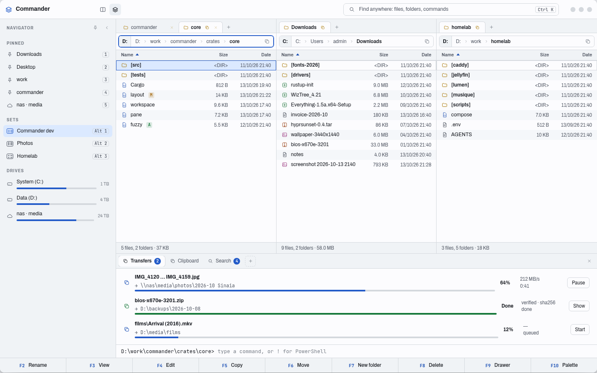

# Ferrite

A keyboard-first file manager for Windows, written in Rust. Rusty is the project's codename; the app is Ferrite (D29). Total Commander's speed and density, plus tiled panes, saved sets of panels, pins, a configurable drawer (transfers, clipboard, search, compare, terminal and more), fast fuzzy search and plugins.

Status: Foundation phase. The workspace, quality gate and CI are in place (plan P1); no application features yet.

- [Discussion so far](docs/discussion.md), including why Rust
- [Architecture](docs/architecture.md): crates, state, caching, start-up, safety, terminal
- [Plugins](docs/plugins.md): what they are, permissions, lifecycle, how to build one
- [Decisions](docs/decisions.md)
- [Roadmap](docs/roadmap.md): phases from foundation to v2.0; visual version in [`design/roadmap.html`](design/roadmap.html)
- Interactive prototypes: open [`design/prototype/picker.html`](design/prototype/picker.html) in a browser (chosen direction: **B**), or the single-file [`design/commander-bundle.html`](design/commander-bundle.html).
- Screenshots of the chosen design: [`design/screens`](design/screens)

## Develop

Prerequisites: Rust 1.99.0 (pinned in `rust-toolchain.toml`) and the tools in [docs/dev-tools.md](docs/dev-tools.md).

`cargo xtask gate` runs the whole quality gate. `cargo xtask gate --coverage` adds the coverage floors. The gate runs, in order:

1. `cargo fmt` check
2. clippy
3. taplo (TOML check)
4. typos
5. size limits
6. l10n: the Fluent files parse, every literal message id exists and is used, and the count of hard-coded texts (capitalised literals of two or more words in non-test code of `rusty-ui` and `rusty-app`) matches `xtask/l10n-allow.txt`
7. cargo-deny
8. cargo-audit
9. nextest
10. doc tests
11. coverage (only with `--coverage`)

Other subcommands: `cargo xtask size`, `cargo xtask l10n [--list]`, `cargo xtask coverage`, `cargo xtask binsize <path>`.

On Linux, `scripts/install-local.sh` builds an `x86-64-v3` binary (as CachyOS does) into `target/x86-64-v3/` and installs it as `~/.local/bin/ferrite`, with its icons and a `.desktop` entry under `~/.local/share`.

The app icon and wordmark live in `assets/brand/`. After editing an SVG there, run `scripts/build-icons.sh` to rebuild the PNG files and `ferrite.ico`.

CI: every push runs the gate on Linux and the tests on Windows, and builds `ferrite.exe` and a Linux `ferrite` binary as artifacts.

Plans live in [plans/](plans/README.md). Each plan is cut into atoms and ends in a gate.
